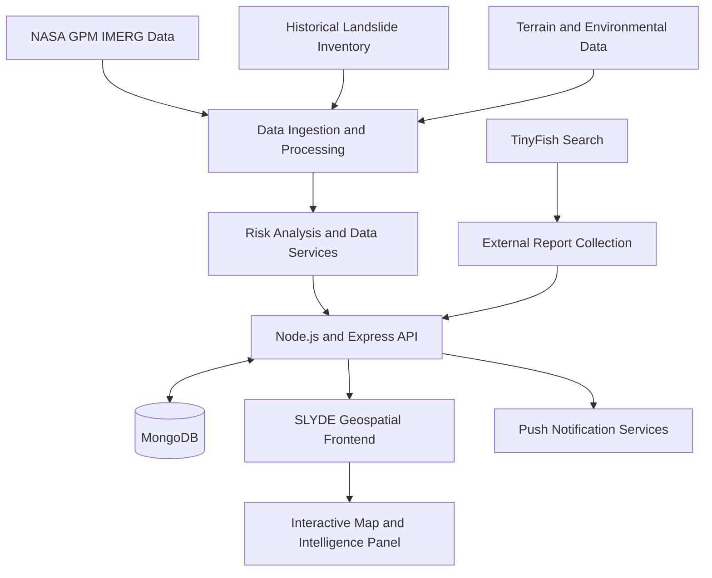

<div align="center">

# SLYDE

### Smart Landslide Intelligence & Detection Engine

**AI-assisted landslide risk intelligence for a safer, more resilient future.**

An integrated geospatial platform combining rainfall data, terrain information, historical landslide records, risk analysis, and external report intelligence for Sikkim, India.

</div>

---

## Overview

SLYDE is a landslide-risk monitoring and decision-support prototype designed to bring environmental data and geospatial intelligence into a unified interface. It helps users explore vulnerable locations, examine rainfall scenarios, visualize documented landslide sites, and access relevant public reports.

By combining data engineering, geospatial visualization, backend services, and AI-assisted analysis, SLYDE aims to make complex environmental information easier to interpret.

## Key Features

- **3D Risk Visualization** — Explore geospatial information through an interactive landslide-risk map.
- **Rainfall Scenario Analysis** — Examine configurable rainfall accumulations over multiple time windows.
- **Landslide Inventory** — Access documented landslide-site information through the backend.
- **Environmental Data Integration** — Support rainfall, satellite and terrain-related data workflows.
- **NASA GPM IMERG Integration** — Process precipitation data for rainfall-related analysis.
- **External Landslide Intelligence** — Discover and display publicly indexed reports using TinyFish Search.
- **Push Notifications** — Backend support for device subscriptions and alert delivery.
- **Safety Information** — Surface emergency information and relevant contextual warnings.

## Platform Architecture

<div align="center">



</div>

## Technology Stack

| Layer | Technologies |
|---|---|
| Frontend | JavaScript, Vite, HTML, CSS |
| Geospatial Visualization | Interactive 3D map and GIS-oriented interface |
| Backend | Node.js, Express.js |
| Database | MongoDB, Mongoose |
| Data Engineering | Python |
| Rainfall Data | NASA GPM IMERG |
| External Intelligence | TinyFish Search API |
| Notifications | Web Push |

## Project Structure

```text
SlopTwin/
├── Backend/
│   ├── node/
│   │   └── src/
│   │       ├── models/
│   │       ├── routes/
│   │       ├── app.js
│   │       └── server.js
│   └── python/
│       └── ingestion/
├── Frontend 2/
│   ├── public/
│   ├── src/
│   │   ├── api.js
│   │   ├── slydeMarkup.js
│   │   └── styles.css
│   └── index.html
└── README.md
```

## External Landslide Intelligence

SLYDE incorporates a separate external-report workflow powered by TinyFish Search. It discovers public web pages related to landslide incidents, advisories, and road conditions, then makes saved reports available to the frontend.

Report entries can include source links, titles, snippets, publication-date text, and verification status. These reports complement the platform's existing data sources rather than replacing the original landslide inventory.

## Data and Model Scope

SLYDE brings together multiple categories of information relevant to landslide-risk analysis:

- Rainfall accumulation and precipitation data
- Historical landslide locations
- Terrain and geological characteristics
- Satellite and environmental data
- External reports and contextual information

The platform is designed to support location-specific exploration and risk awareness. Model performance and operational usefulness depend on data quality, representative training samples, validation, and reliable ground observations.

## Project Goals

- Make environmental and geospatial information easier to explore.
- Improve access to location-oriented landslide-risk insights.
- Integrate heterogeneous data sources into a unified platform.
- Present external reports alongside existing intelligence with clear provenance.
- Support future improvements in regional validation and early-warning workflows.

## Current Scope

SLYDE is an evolving prototype focused on Sikkim. Its components include the geospatial frontend, Node.js API, MongoDB-backed data services, rainfall-ingestion workflows, push-notification support, and external-report discovery.

External search results are not automatically verified incidents, and model outputs should be interpreted as decision-support information rather than definitive predictions. SLYDE is not a substitute for official disaster-management alerts or professional assessment.

---

<div align="center">

**SLYDE — Turning environmental data into actionable awareness.**

*Built for landslide-risk intelligence, geospatial exploration, and resilience.*

</div>
